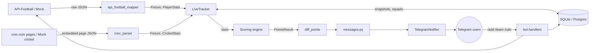

# Architecture

## Data flow

## Layers and rules

| Layer | Knows about | Never imports |
|---|---|---|
| `domain` | nothing | everything else |
| `scoring` | `domain` | providers, storage, telegram |
| `providers` | `domain` | storage, telegram |
| `storage` | `domain` | providers, telegram |
| `live` | the four above, via protocols | telegram |
| `fantasy` | `domain`, `scoring`, `storage`, providers via protocols | telegram, fastapi |
| `api` | `fantasy` and the layers below | telegram |
| `bot` | everything except `api` | |

Only `bot/` imports `telegram`, so the core can be reused for a web dashboard or another
messenger by writing a new `Notifier` and front end.

## Sports

One bot instance serves one sport, set by `DATA_PROVIDER` (`config.PROVIDER_SPORTS`). The
sport-specific pieces are:

| Piece | Football | Cricket |
|---|---|---|
| Stats (`domain.py`) | `PlayerStats` | `CricketStats` |
| Positions | `Position` | `CricketPosition` |
| Rules / engine | `ScoringRules`, `engine.calculate_football` | `CricketRules`, `cricket.calculate_cricket` |
| Ruleset | `dream11_football.toml` | `dream11_cricket.toml` (`sport = "cricket"`) |

Everything else is shared. `calculate_points` dispatches on the rules type, `diff_points`
works on score lines for either sport, and the repository rebuilds snapshots with the
ruleset's `stats_type`. Startup fails if the ruleset's sport doesn't match the provider's.

**Providers never compute points.** They map raw stats only (runs, balls, boundaries,
dismissals, overs, wickets, maidens, catches, goals, cards...); CREX's own fantasy points are
ignored. Every point comes from the ruleset.

## Fantasy teams and the web API

`fantasy/service.py` holds everything about user-built teams: which players a team may pick
(a series' squads, or one match's two sides), size and captaincy rules, locking match teams at
the start, and scoring a team over every started match of its series. `api/app.py` is a thin
FastAPI layer over it; see [API.md](API.md).

Series support is an optional provider extension (`SeriesProvider`: `list_series`,
`series_matches`, `series_players`), implemented by the CREX scraper and the cricket mock.
CREX's series pages (`/series`, `/series/<slug>-<key>`, `.../matches`) embed the same kind of
page JSON as match pages.

| Table | Purpose |
|---|---|
| `fantasy_teams` | team name, owner, series, optional match |
| `fantasy_team_players` | picks with denormalised player details and C/VC role |
| `match_scorecards` | finished matches' raw stats, so scores never re-scrape them |
| `pools` | a user's pool: name, type (normal / dream), series, optional match |

`fantasy_teams.pool_id` links a team to its pool. `init_db` adds that column to databases
created before pools existed (`ADDED_COLUMNS` in `storage/database.py`).

## Live tracking

`LiveTracker` runs two jobs on the bot's job queue:

1. **Schedule refresh** (every `SCHEDULE_REFRESH_SECONDS`): one `GET /fixtures?date=` per day
   for yesterday and today, filtered locally to `LEAGUE_IDS`.
2. **Poll** (every `LIVE_POLL_SECONDS`): picks fixtures that are inside their tracking window
   (kickoff − 10 min to kickoff + 3 h, not finished) **and** involve a team someone has a
   player from. If none, it returns without any API call. Otherwise it fetches all of them in
   one `GET /fixtures?ids=a-b-c` (up to 20 per call), which includes score, events and
   per-player stats.

For each fixture it:

1. loads the last stored `StatSnapshot` for every watched player,
2. computes `diff_points(old, new)` from the score lines, so any rule (including losing a
   clean sheet) produces an alert without special cases,
3. saves the new snapshots **before** sending, so a crash can drop an alert but never repeat
   one, and a restart never re-announces old goals,
4. groups changes per user, applies that user's captain/vice-captain multiplier, and sends
   one message per user per poll,
5. on the poll where the fixture turns `FT`/`AET`/`PEN`, sends a full-time summary.

If a user blocks the bot, the notifier reports it and their alerts are switched off.

## CREX cricket scraper

CREX is an Angular app rendered on the server, and each page embeds the JSON it was built
from in `<script id="app-root-state">`. The scraper reads that JSON from three public pages
and nothing else. It never calls CREX's private APIs (`crex.com/api/*` is disallowed in
robots.txt, and the `*.crickapi.com` and `api.goscorer.com` backends aren't touched).

| Page | Used for | Cached |
|---|---|---|
| `/` | `getLiveMatches`: live, recent and upcoming matches (teams, status, kickoff, scores) | 60 s |
| `/cricket-live-score/match-updates-<key>/match-scorecard` | `getSC4`: compact scorecard of every innings | 20 s |
| `/cricket-live-score/match-updates-<key>/match-details` | `getIV4`: squads, playing XIs, roles, wicketkeepers | 6 h once the XI is known, else 1 h |

It sends one request at a time, at least a second apart, with an honest User-Agent
(`FantasyPointsBot/0.1`). A live match costs one scorecard request per poll. Squads are loaded
in the background when the schedule refreshes, so `/add` searches are served from cache.

The compact scorecard format and its dismissal codes (1 bowled, 2 caught, 3 caught and
bowled, 4 run out, 5 LBW, 8 stumped) are documented in `providers/crex_parser.py`. They were
checked against CREX's rendered scorecards for a dozen matches. If CREX changes its page
layout, `ProviderError` is raised and logged, and `tests/fixtures/crex` shows the expected
shape.

Known gaps: CREX doesn't publish dot balls per bowler, so the cricket ruleset has no
dot-ball points. Roles come from the squad page (batter, bowler, all-rounder, plus the
designated keeper), and players with no squad entry default to batter.

## API quota

API-Football's free plan allows 100 requests/day.

| Activity | Requests |
|---|---|
| Schedule refresh (default every 3 h, 2 days each) | 16/day |
| One live match tracked at 120 s polls (~2.5 h window) | ~75 |
| Each `/calc` | 2–3 (team's live/last fixture + details), cached 2 min |
| Each `/add` search | 1 per followed league, cached 1 h |

Several simultaneous matches still cost one request per poll, because ids are batched. For a
busy matchday on the free plan raise `LIVE_POLL_SECONDS` (e.g. 300) or upgrade the plan.

## Storage

| Table | Purpose |
|---|---|
| `users` | Telegram chat id, alerts on/off |
| `squad_players` | (chat, player) with denormalised name/team/position and role |
| `stat_snapshots` | last stats seen per (fixture, player); drives diffing and `/team` totals |

Tables are created on startup. When the schema needs to change, add Alembic migrations.

## Known approximations

- **Cricket strike-rate and economy points** change ball by ball, so they're left out of live
  alerts (`live_quiet_keys`) but included in totals, `/calc` and the end-of-match summary.

- **Clean sheet** uses the team's goals conceded for the whole match, not only while the player
  was on the pitch. API-Football doesn't expose per-player goals conceded for outfield players.
- **Own goals** come from the fixture's event feed (player stats don't include them).
